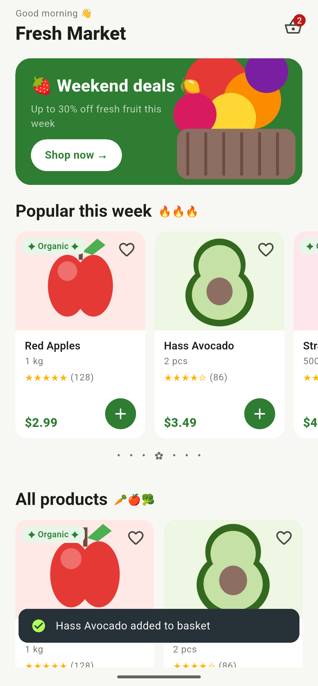
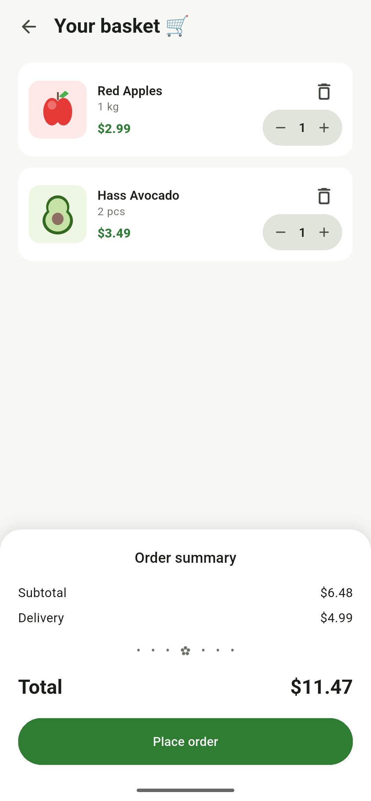

# Fresh Market (a11y_first_aid)

A small grocery demo app built with Flutter 3.47.8, used in the **Accessibility First Aid** workshop.

The app looks like a normal production app on purpose, but **accessibility was never implemented**.
Your job is to fix it, so that a screen reader user can shop as easily as anyone else.

Everything runs on mock data: no network, no API keys.

| Products | Basket |
|---|---|
|  |  |

- **Products**: a promo banner, a "Popular this week" carousel and an "All products" grid. You can add products to the basket and mark favourites.
- **Basket**: change quantities, remove items and place an order. There is no payment step: placing the order only clears the basket.

## Getting started

Please do these steps **before the workshop**. They take about 15 minutes if Flutter is already installed.

### 1. What you need

| Tool | Version | Check with |
|---|---|---|
| Flutter | **3.47.0 or newer** | `flutter --version` |
| Dart | **3.13.0 or newer** (comes with Flutter, no separate install) | `dart --version` |
| Git | any recent version | `git --version` |
| IDE | VS Code with the *Flutter* extension, or Android Studio with the *Flutter* plugin | |
| Device | An Android phone/emulator **or** an iPhone/iOS simulator (iOS needs a Mac with Xcode) | `flutter devices` |

A **real phone is best**, because you can test with a real screen reader (TalkBack or VoiceOver).

Don't have Flutter yet? Follow the official guide: https://docs.flutter.dev/get-started/install

Have an older Flutter? Update it:

```bash
flutter upgrade
```

### 2. Check your setup

```bash
flutter doctor
```

Fix anything marked with ✗ for the platform you will use (Android toolchain or Xcode).
Warnings for platforms you don't use (for example Chrome or Visual Studio) are fine.

### 3. Clone the project

<!-- TODO: replace <REPO_URL> with the repository link. -->

```bash
git clone <REPO_URL>
cd a11y_first_aid
```

No Git? Download the project as a ZIP from the repository page, unzip it and open the folder.

### 4. Install dependencies

```bash
flutter pub get
```

If you see an error that says `a11y_first_aid requires Flutter SDK version >=3.47.0`,
your Flutter is too old: run `flutter upgrade` and try again.

### 5. Run the app

Start an emulator or connect your phone (with USB debugging on Android), then:

```bash
flutter devices   # your device should be on the list
flutter run
```

You can also press **Run** (▶) in your IDE.
You should see the Fresh Market home screen with products. 🎉

### 6. Run the tests

```bash
flutter test
```

All tests should pass. Run them again after your fixes to make sure nothing broke.

### 7. Turn on the screen reader

**Android (TalkBack)**
1. Settings → Accessibility → TalkBack → turn it on.
2. Swipe right / left to move between items, double-tap to activate.
3. To jump between headings: in TalkBack's *reading controls* choose *Headings*, then swipe down for the next heading and up for the previous one.
   The gesture that opens reading controls depends on your TalkBack version: see *TalkBack settings → Tutorial and help*.

**iOS (VoiceOver)**
1. Settings → Accessibility → VoiceOver → turn it on.
2. Swipe right / left to move between items, double-tap to activate.
3. To jump between headings: rotate two fingers on the screen (the *rotor*), choose *Headings*, then swipe up / down.

Tip: set up the **Accessibility Shortcut** (triple-click the side button on iPhone, or hold both volume keys on Android)
so you can turn the screen reader on and off quickly.

**No phone?** Uncomment `showSemanticsDebugger: true` in `lib/app/app.dart` and hot restart.
Every box on screen is one screen reader stop, labelled with what will be read.

### Troubleshooting

| Problem | Fix |
|---|---|
| `flutter: command not found` | Flutter is not on your `PATH`. See the install guide above |
| Version error during `flutter pub get` | `flutter upgrade` |
| `No devices found` | Start an emulator / simulator, or connect your phone and allow USB debugging |
| Strange build errors after upgrading | `flutter clean && flutter pub get`, then run again |
| iOS: signing error on a real iPhone | Open `ios/Runner.xcworkspace` in Xcode, choose your team under *Signing & Capabilities* |

## Workshop

The workshop covers four topics:

1. **Semantics**: buttons have names, related texts are read together, decoration is silent.
2. **Alt text**: images are described or hidden.
3. **Headings**: users can jump between sections.
4. **Status messages**: confirmations and errors are announced.

Reading order is already correct, so you don't need to fix it.

### How to work

1. Search the project for `TODO(a11y)`, or open the TODO panel in your IDE.
2. Each task has an ID, for example `[H1 Heading]`. The comment explains what is wrong and shows the fix as code you can copy.
3. Make the fix and run the app.
4. Check the result: turn on **TalkBack** (Android) or **VoiceOver** (iOS), or uncomment `showSemanticsDebugger: true` in `lib/app/app.dart` to see each screen reader stop on screen.
5. Run `flutter test` to make sure nothing broke.

Go through the topics in the order above. Each task takes a few minutes.

### 1. Semantics

| ID | File | What the screen reader says now |
|---|---|---|
| S1 | `cart_badge_button.dart` | "2, button" (no name) |
| S2 | `product_card.dart` | "Button" (favourite: no name, no selected state) |
| S3 | `product_card.dart` | "Button" (add to basket: no name) |
| S4 | `product_card.dart` | Name, unit, rating and price as 4 separate stops |
| S5 | `rating_stars.dart` | "Black star, black star, white star… (128)" |
| S6 | `organic_badge.dart` | "Four-pointed star, Organic, four-pointed star" |
| S7 | `section_title.dart` | "Fire, fire, fire" |
| S8 | `decorative_divider.dart` | "Bullet, bullet, bullet…" |
| S9 | `home_top_bar.dart` | "Good morning, waving hand" |
| S10 | `promo_banner.dart` | Banner is not a button; emojis and arrow are read aloud |
| S11 | `cart_screen.dart` | "Button" (back: no name) |
| S12 | `cart_item_tile.dart` | "Button" (delete: no name) |
| S13 | `quantity_stepper.dart` | "Button, 2, button" (−/+ have no name, bare number) |
| S14 | `cart_item_tile.dart` | Name, unit and price as 3 separate stops |
| S15 | `cart_summary.dart` | "Subtotal" and "$6.48" as separate stops |
| S16 | `cart_summary.dart` | "Free, party popper" |
| S17 | `empty_cart_view.dart` | "Basket, leaf, leaf" |

### 2. Alt text

Ask: *does the image tell me something the text does not?*
If yes, describe it with `semanticLabel: '...'`. If no, hide it with `excludeFromSemantics: true`.

| ID | File | Problem |
|---|---|---|
| A1 | `product_card.dart` | Product image has no alt text (decorative: the name is next to it) |
| A2 | `promo_banner.dart` | Banner image has no alt text (decorative) |
| A3 | `cart_item_tile.dart` | Product image has no alt text (decorative) |

### 3. Headings

Use `Semantics(headingLevel: 1)` for the screen title and `headingLevel: 2` for sections.

> Don't use `header: true`. In Flutter 3.47, TalkBack and VoiceOver read headings from `headingLevel` only.

| ID | File | Problem |
|---|---|---|
| H1 | `home_top_bar.dart` | "Fresh Market" is not a heading (custom top bar, no `AppBar`) |
| H2 | `section_title.dart` | "Popular this week" and "All products" are not headings |
| H3 | `cart_screen.dart` | "Your basket" is not a heading |
| H4 | `cart_summary.dart` | "Order summary" is not a heading |
| H5 | `empty_cart_view.dart` | "Your basket is empty" is not a heading |

### 4. Status messages

Use `SemanticsService.sendAnnouncement` for messages that appear for a moment (like a toast),
and `Semantics(liveRegion: true)` for content that appears on screen and stays.

| ID | File | Problem |
|---|---|---|
| M1 | `core/widgets/app_toast.dart` | "Added to basket" and "Order placed" toasts are silent. One fix covers both |
| M2 | `products_screen.dart` | Loading spinner has no label |
| M3 | `products_screen.dart` | "Something went wrong" is not announced when it appears |

### Cheat sheet

| Tool | Use it for |
|---|---|
| `IconButton(tooltip: ...)` | Naming an icon-only button |
| `IconButton(isSelected: ...)` | Saying whether a toggle (like favourite) is on |
| `Semantics(button: true)` | Telling the user that a custom tappable widget is a button |
| `Text(..., semanticsLabel: ...)` | Changing what is read without changing what is shown |
| `ExcludeSemantics` | Hiding decoration |
| `MergeSemantics` | Reading several texts as one stop |
| `Image(semanticLabel: ...)` / `excludeFromSemantics: true` | Informative / decorative images |
| `Semantics(headingLevel: 1)` / `headingLevel: 2` | Headings (screen title / section) |
| `CircularProgressIndicator(semanticsLabel: ...)` | Saying what is loading |
| `SemanticsService.sendAnnouncement` | Announcing a short message |
| `Semantics(liveRegion: true)` | Announcing content when it appears or changes |

## Architecture

The app uses a feature-first layout with layered MVVM (`ChangeNotifier` view models + `ListenableBuilder`, no third-party packages).

```
lib/
├── main.dart
├── app/                       # App root, routes, dependency wiring
├── core/
│   ├── formatting/            # PriceFormatter
│   ├── theme/                 # Colors and ThemeData
│   └── widgets/               # AppToast, DecorativeDivider
└── features/
    ├── products/
    │   ├── data/              # Mock data source, DTO, repository impl
    │   ├── domain/            # Product entity, repository contract
    │   └── presentation/      # ProductsViewModel, screen, widgets
    └── cart/
        ├── data/              # In-memory cart repository
        ├── domain/            # CartItem entity, repository contract
        └── presentation/      # CartViewModel, screen, widgets
```
